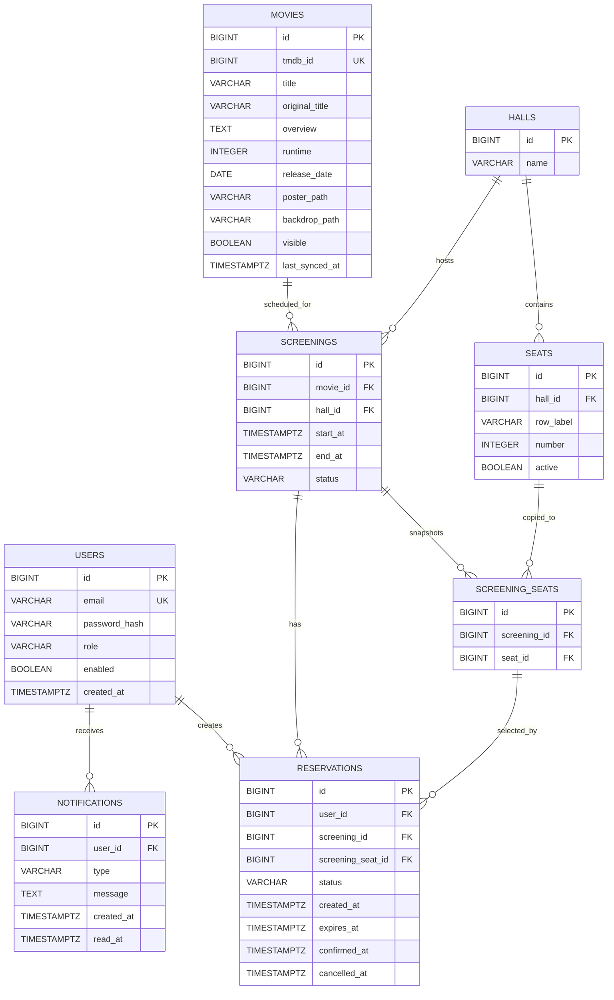

# RowZero - ERD

Poniższy diagram przedstawia aktualny model danych aplikacji RowZero.

## Relacje

- Jeden użytkownik może posiadać wiele rezerwacji.
- Jeden użytkownik może posiadać wiele powiadomień.
- Jeden film może być przypisany do wielu seansów.
- Jedna sala posiada wiele miejsc.
- Jeden seans odbywa się w jednej sali.
- Każdy seans posiada własny snapshot miejsc w tabeli `screening_seats`.
- Jedna rezerwacja dotyczy jednego użytkownika, jednego seansu i jednego `screening_seat`.
- Fizyczne miejsce z tabeli `seats` może występować w wielu rekordach `screening_seats` dla różnych seansów.

## Znaczenie `ScreeningSeat`

`Seat` opisuje fizyczne miejsce w sali, np. `A1`.

`ScreeningSeat` jest kopią przypisania miejsca do konkretnego seansu. Dzięki temu rezerwacja odnosi się do miejsca w kontekście konkretnego seansu, a nie wyłącznie do fizycznego miejsca w sali.

## Statusy

### Reservation

- `HELD`
- `CONFIRMED`
- `CANCELLED`
- `EXPIRED`

### Screening

- `SCHEDULED`
- `CANCELLED`

## Najważniejsze ograniczenia logiczne

- aktywna rezerwacja oznacza status `HELD` lub `CONFIRMED`,
- jedno `ScreeningSeat` nie może posiadać dwóch aktywnych rezerwacji,
- jeden użytkownik nie może posiadać dwóch aktywnych rezerwacji na ten sam seans,
- użytkownik nie może posiadać aktywnych rezerwacji na nakładające się czasowo seanse,
- miejsce musi należeć do sali przypisanej do seansu,
- seanse w tej samej sali nie mogą nakładać się czasowo,
- dezaktywacja użytkownika anuluje jego przyszłe aktywne rezerwacje.
